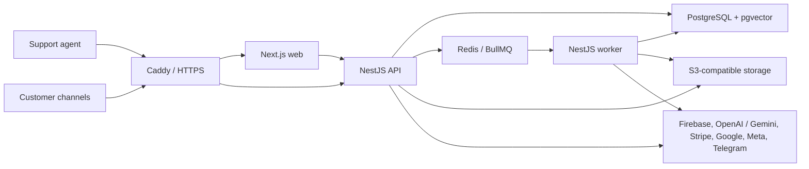

# Chanda AI

Chanda AI is a multi-tenant support operations platform that brings customer conversations from web chat, Telegram, Gmail, WhatsApp, Facebook Messenger, and Instagram into one workspace. It combines tenant-scoped knowledge retrieval with human-reviewed AI drafts, ticket workflows, team permissions, analytics, retrieval evaluation, and Stripe subscriptions.

[Live application](https://chanda.hafzism.in)

## What the product does

- Normalizes supported channels into one inbox, customer, conversation, message, and ticket model.
- Imports text, Markdown, and PDF knowledge and indexes it asynchronously.
- Combines PostgreSQL full-text search and pgvector semantic search using reciprocal-rank fusion.
- Generates grounded OpenAI or Gemini drafts with exact evidence, deterministic risk rules, and explicit human approval before sending.
- Supports workspace roles, invitations, channel credential encryption, and tenant-scoped authorization.
- Measures support operations and retrieval quality with first-response analytics, Hit@5, MRR, and hybrid-availability metrics.
- Projects Stripe subscription events into local Free/Pro entitlements.
- Deploys an immutable container release to AWS through GitHub Actions, OIDC, and Systems Manager.

## Architecture



The codebase is a modular monolith with a separately deployable worker. Web, API, worker, and widget are independent runtime/build boundaries, while domain data and migrations remain coordinated in one repository.

## Technology stack

| Area             | Technology                                                                                    |
| ---------------- | --------------------------------------------------------------------------------------------- |
| Frontend         | Next.js 16, React 19, TypeScript, Tailwind CSS                                                |
| API              | NestJS 11, TypeScript, class-validator                                                        |
| Background work  | NestJS worker, BullMQ, Redis                                                                  |
| Data             | PostgreSQL 17, Drizzle ORM, pgvector, full-text search                                        |
| AI and retrieval | Workspace-owned OpenAI or Gemini keys, deterministic chunking, hybrid retrieval, RRF          |
| Identity         | Firebase Authentication and Firebase Admin; application-owned HttpOnly sessions               |
| Storage          | MinIO locally, private Amazon S3 in production                                                |
| Integrations     | Telegram Bot API, Gmail API/OAuth, Meta Graph API, Stripe                                     |
| Tooling          | pnpm workspaces, Turborepo, Vitest, ESLint, Prettier                                          |
| Delivery         | Docker, Docker Compose, Caddy, AWS CloudFormation, SSM, CloudWatch, GitHub Actions/OIDC, GHCR |

LangChain is intentionally not used. Retrieval, prompt versioning, provider calls, evidence policy, and evaluation are implemented behind small typed application boundaries so their behavior is visible and testable.

## Repository layout

```text
apps/
  web/             Next.js dashboard, authentication, onboarding, and channel UI
  api/             NestJS HTTP API and synchronous application workflows
  worker/          Asynchronous outbox, indexing, embedding, and job processing
  widget/          Dependency-free embeddable customer chat widget
packages/
  contracts/       Stable shared contracts
  database/        Drizzle schema, migrations, and database client
  knowledge/       Deterministic chunking and hybrid-ranking logic
  observability/   Structured logging and redaction utilities
deploy/aws/        CloudFormation, production Compose, Caddy, deploy, and backup tools
.github/workflows/ Verification and production release workflows
```

## Engineering guides

- [Workspace AI providers and BYOK](docs/AI_PROVIDER_BYOK.md)
- [Production readiness and operations](docs/PRODUCTION_READINESS.md)
- [Authenticated UI system](docs/AUTHENTICATED_UI_SYSTEM.md)
- [Brand identity and assets](docs/BRAND_ASSETS.md)

## Local development

### Prerequisites

- Node.js 24
- pnpm 11
- Docker with Docker Compose
- A Firebase project with Google and Email/Password authentication enabled
- Two stable, independently generated 32-byte encryption keys for stored AI and channel credentials

Channel and billing credentials are optional until those integrations are exercised.

### 1. Install the repository

```bash
git clone <repository-url>
cd <repository-directory>
corepack enable
corepack prepare pnpm@11.7.0 --activate
pnpm install --frozen-lockfile
```

### 2. Configure the environment

```bash
cp .env.example .env
chmod 600 .env
node scripts/configure-local-services.mjs
```

Fill the remaining required values in `.env`. The setup script creates permission-restricted `apps/api/.env.local`, `apps/web/.env.local`, and `apps/worker/.env.local` files for the local service addresses.

Firebase browser values come from Firebase Console → Project settings → Your apps. Firebase Admin values come from a downloaded service-account JSON file. Configure both safely with:

```bash
node scripts/configure-firebase.mjs \
  --service-account /absolute/path/to/service-account.json \
  --api-key '<firebase-web-api-key>' \
  --auth-domain '<project-id>.firebaseapp.com' \
  --project-id '<project-id>' \
  --app-id '<firebase-web-app-id>'
```

The script validates that the client and Admin projects match, writes the multiline private key safely, and keeps the generated files at mode `0600`. Delete or securely archive the downloaded JSON after configuration; it must never enter Git.

Generate separate AI-provider and channel credential keys with:

```bash
openssl rand -base64 32 # AI_PROVIDER_CREDENTIALS_ENCRYPTION_KEY
openssl rand -base64 32 # CHANNEL_CREDENTIALS_ENCRYPTION_KEY
```

Each decoded value must be exactly 32 bytes. Keep the keys separate and stable. Replacing either key without a rotation migration makes its existing ciphertext unreadable.

### 3. Start local dependencies

```bash
docker compose up -d
```

Create the bucket named by `S3_BUCKET` in MinIO at [http://localhost:59001](http://localhost:59001) using the local credentials from `compose.yaml`.

### 4. Migrate and run

```bash
pnpm --filter @suppline/database db:migrate
pnpm dev
```

Open [http://localhost:3000](http://localhost:3000). The API runs on [http://localhost:4000](http://localhost:4000), and API liveness is available at `/v1/health`.

## Environment reference

Never commit a populated `.env` file or a Firebase service-account JSON file.

| Group                  | Variables                                                                          | Purpose                                                   |
| ---------------------- | ---------------------------------------------------------------------------------- | --------------------------------------------------------- |
| Runtime                | `WEB_PORT`, `API_PORT`, `API_INTERNAL_URL`, `WEB_APP_ORIGIN`, `WEB_APP_URL`        | Web/API addresses and same-origin proxy routing           |
| Data                   | `DATABASE_URL`, `REDIS_URL`                                                        | PostgreSQL and queue/cache connectivity                   |
| Object storage         | `S3_ENDPOINT`, `S3_REGION`, `S3_BUCKET`, `S3_ACCESS_KEY`, `S3_SECRET_KEY`          | MinIO locally; EC2 IAM role and S3 in AWS                 |
| Firebase browser       | `NEXT_PUBLIC_FIREBASE_*`                                                           | Public Firebase Web SDK configuration                     |
| Firebase server        | `FIREBASE_PROJECT_ID`, `FIREBASE_CLIENT_EMAIL`, `FIREBASE_PRIVATE_KEY`             | Firebase Admin token verification                         |
| AI credential security | `AI_PROVIDER_CREDENTIALS_ENCRYPTION_KEY`                                           | Encrypts workspace-owned OpenAI or Gemini keys            |
| Channel security       | `CHANNEL_CREDENTIALS_ENCRYPTION_KEY`                                               | Encrypts Gmail, Telegram, WhatsApp, and Meta credentials  |
| Gmail                  | `GOOGLE_GMAIL_CLIENT_ID`, `GOOGLE_GMAIL_CLIENT_SECRET`, `GMAIL_OAUTH_REDIRECT_URI` | Gmail OAuth and mailbox synchronization                   |
| Meta/Telegram          | `META_GRAPH_API_VERSION` and webhook base URLs                                     | Public provider callback construction                     |
| Stripe                 | `STRIPE_SECRET_KEY`, `STRIPE_PRO_PRICE_ID`, `STRIPE_WEBHOOK_SECRET`                | Checkout, Customer Portal, and signed subscription events |

Use `.env.example` for development and `deploy/aws/.env.production.example` for the EC2 runtime inventory.

## Provider setup notes

- AI: each workspace owner or admin selects OpenAI or Google Gemini in **AI provider**, enters a key once, and validates it before storage. Chanda encrypts the key with workspace/provider-bound authenticated encryption and never returns it to the browser.
- Firebase: add the deployed hostname to Authentication → Authorized domains. Basic Google sign-in requests identity scopes and is separate from Gmail mailbox access.
- Gmail: enable the Gmail API, create a Web application OAuth client, and register `https://<domain>/v1/public/gmail/oauth/callback`. While the consent screen is in Testing, connected Gmail accounts must be listed as test users. Public use of Gmail scopes requires Google's verification process.
- Telegram: the application validates the BotFather token and registers its generated webhook automatically. Telegram needs a public HTTPS origin.
- WhatsApp, Facebook, and Instagram: connect credentials in the Channels screen, then copy the generated callback URL and one-time verify token into the Meta developer console. Development/test assets and users remain subject to Meta app-mode restrictions; public use requires the relevant permissions and App Review.
- Stripe: create a recurring Price, enable Customer Portal settings, and register `https://<domain>/v1/public/stripe/webhook`. Use the endpoint's signing secret, not a temporary local Stripe CLI secret, in production.

## Quality checks

```bash
pnpm format:check
pnpm lint
pnpm typecheck
pnpm test
pnpm test:integration
pnpm build
```

`pnpm verify` runs formatting, linting, strict type checking, unit tests, and production builds. Integration tests additionally require PostgreSQL.

## AWS deployment

The production topology is intentionally small: one EC2 host runs Caddy, web, API, worker, PostgreSQL, and Redis as separate containers. Private S3 buckets store knowledge and backups. CloudWatch receives container logs and alarms. Only ports 80 and 443 are public; administration uses AWS Systems Manager instead of SSH.

1. Create the account-level GitHub Actions OIDC provider for `token.actions.githubusercontent.com`.
2. Deploy `deploy/aws/infrastructure.yaml` with the VPC, subnet, GitHub owner/repository, alert email, and OIDC provider ARN parameters. The stack returns the instance ID, Elastic IP, deploy-role ARN, log group, and S3 bucket names.
3. Point the application domain's DNS A record to the Elastic IP.
4. Through Systems Manager Session Manager, clone the repository to `/opt/suppline-ai`, copy `deploy/aws/.env.production.example` to `.env.production`, fill it, and set mode `0600`.
5. Add the stack outputs and Firebase browser configuration as GitHub production environment variables.
6. Configure every external provider's production callback/authorized-domain value.
7. Push to `main`. After Verify succeeds, the Release workflow builds an immutable `sha-<commit>` image in GHCR. Approve the protected `production` environment; GitHub then obtains short-lived AWS credentials through OIDC and asks SSM to run the health-gated deployment.
8. Install the supplied systemd backup timer, verify a backup archive, and perform an isolated restore drill before treating backups as recovery-ready.

Caddy obtains and renews TLS certificates automatically after DNS resolves and ports 80/443 reach the instance. No certificate or private key is stored in this repository.

## CI/CD behavior after a change

A local edit is not automatically production. The normal path is:

1. Run the relevant tests and `pnpm verify`.
2. Commit and push the change to `main` (or merge a reviewed pull request into `main`).
3. GitHub's Verify workflow must pass.
4. The Release workflow builds and publishes an immutable image for that exact commit.
5. A maintainer approves the `production` environment deployment.
6. GitHub uses OIDC to obtain temporary AWS credentials and sends a command through SSM.
7. EC2 fast-forwards the repository, pulls the immutable image, runs database migrations, starts the containers, and waits for health checks.

If verification, migration, container health, or the SSM command fails, the workflow fails instead of reporting a successful release. Provider-console changes, new environment variables, database migrations, IAM changes, and CloudFormation changes may require their corresponding external setup in addition to pushing code.

## Security and reliability highlights

- Workspace ownership and tenant filters are enforced at database/service boundaries.
- Firebase proves identity; the API issues hashed, revocable, HttpOnly application sessions.
- Webhooks are signature/secret verified and provider event IDs are deduplicated.
- Channel tokens and OAuth refresh tokens are encrypted with AES-256-GCM and are write-only in the UI.
- The transactional outbox bridges PostgreSQL state to at-least-once BullMQ jobs.
- AI never auto-sends: evidence quality, deterministic risk rules, and human approval remain explicit.
- Structured logs redact sensitive fields and carry request/workspace/job correlation identifiers.
- Production data services have no public host ports, and EC2 has no SSH ingress.

## Current scope

The core application and its AWS delivery path are operational. Before using it for real customer data, complete provider production reviews, Stripe live-mode setup, backup restore testing, privacy/legal documentation, load testing, browser accessibility testing, incident alert verification, and a secrets-management/rotation plan.
