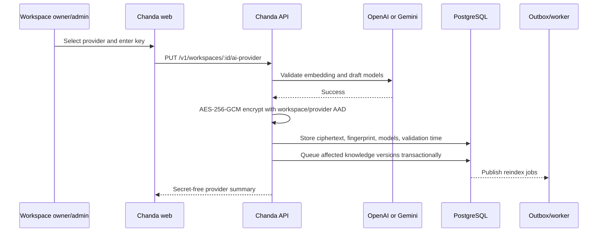

# Workspace AI providers (BYOK)

Chanda AI uses a bring-your-own-key model. Each workspace supplies one OpenAI or Google Gemini key; Chanda does not use a platform-wide provider key for customer work.

## Runtime flow



The browser sends the key once over the authenticated, same-origin API route. The API validates it before persistence. Read responses contain the provider, selected server-side models, dimensions, and timestamps—never the key, ciphertext, or fingerprint.

Only workspace owners and admins can replace or remove a key. Agents and viewers may read the secret-free connection status.

## Supported provider contract

| Provider      | Generation         | Embeddings                                    | API path                                                                 |
| ------------- | ------------------ | --------------------------------------------- | ------------------------------------------------------------------------ |
| OpenAI        | `gpt-5.6-luna`     | `text-embedding-3-small`, 1,536 dimensions    | Responses API with strict JSON Schema and `store: false`; Embeddings API |
| Google Gemini | `gemini-3.6-flash` | stable `gemini-embedding-2`, 1,536 dimensions | Interactions API with `store: false`; Embeddings API                     |

The application owns these model choices. A client cannot submit an arbitrary model name or embedding dimension. Stored configuration is rejected at runtime if it no longer matches the approved server mapping; reconnecting validates and records the current mapping.

Current official references:

- [OpenAI API quickstart](https://platform.openai.com/docs/quickstart/make-your-first-api-request)
- [OpenAI Structured Outputs for the Responses API](https://github.com/openai/openai-node/blob/main/docs/structured-outputs.md)
- [OpenAI API data controls](https://platform.openai.com/docs/models/default-usage-policies-by-endpoint)
- [Google Gemini latest-model guide](https://ai.google.dev/gemini-api/docs/latest-model)
- [Google Gemini Interactions API](https://ai.google.dev/gemini-api/docs/interactions-overview)
- [Gemini Embedding 2](https://ai.google.dev/gemini-api/docs/models/gemini-embedding-2)
- [Gemini API key security and migration](https://ai.google.dev/gemini-api/docs/api-key)

Google states that standard Gemini keys will be rejected beginning in September 2026. Workspace administrators should create authorization keys or migrate before that date.

## Storage and cryptography

`AI_PROVIDER_CREDENTIALS_ENCRYPTION_KEY` is a canonical base64 encoding of exactly 32 random bytes. Generate it independently from every other application secret:

```bash
openssl rand -base64 32
```

The key encrypts provider credentials using AES-256-GCM with a fresh 96-bit IV. Additional authenticated data binds every ciphertext to:

```text
chanda:workspace-ai-provider:<workspace-id>:<provider>
```

Moving ciphertext to another workspace or changing its provider makes authentication fail. A SHA-256 fingerprint supports internal comparison without storing a second recoverable copy. It is not exposed by the API.

The root encryption key must be supplied only to the API and worker. It must never be a `NEXT_PUBLIC_*` variable, browser bundle value, provider key, or channel-credential key. Production configuration validation rejects missing, short, or non-canonical values.

## Knowledge indexing behavior

The selected embedding provider is part of the index contract. On first configuration or when provider/model/dimensions change, the API increments the workspace embedding revision and transactionally queues every knowledge version for reindexing. The worker resolves and decrypts the key only while making a provider request and verifies that the revision did not change before marking an index ready.

Replacing a key for the same provider/model does not require reindexing because the vector space is unchanged. Removing the provider stops AI drafts and semantic retrieval; keyword retrieval remains available.

## Failure behavior

- Provider `400`, `401`, `403`, `404`, and `429` responses are treated as key, entitlement, model-access, or quota rejection and return a safe validation error.
- Network failures, timeouts, malformed provider output, and upstream `5xx` failures return a recoverable service-unavailable response instead of claiming the key is invalid.
- A missing workspace provider produces keyword-only search and prevents AI draft generation.
- Provider responses are schema-validated, bounded, and treated as untrusted input.
- Customer transcript and retrieved evidence are also marked as untrusted in the system instruction. The model may draft from approved evidence but cannot authorize sending.

## Rotation and incident response

The current root-key rotation is an operator-controlled maintenance operation; do not simply replace the environment value. A safe rotation must decrypt every row with the old key, re-encrypt it with a new key, verify every row, deploy the new key, and only then retire the old key. Back up the database before beginning and perform the operation in a maintenance window.

If a workspace provider key is exposed, the workspace owner should:

1. Create a replacement key at the provider.
2. Use **AI provider → Replace API key** and wait for validation.
3. Revoke the old provider key.
4. Review provider usage and billing alerts.

If the Chanda root encryption key may be exposed, treat all encrypted workspace credentials as potentially exposed, rotate the root key through a verified migration, and ask every affected workspace to rotate its provider key.
